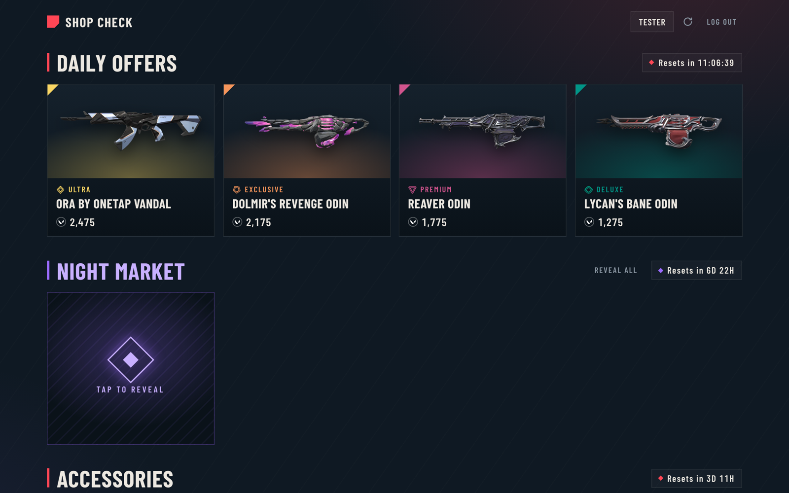
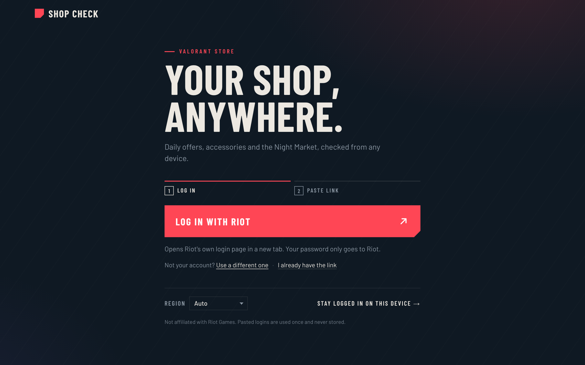
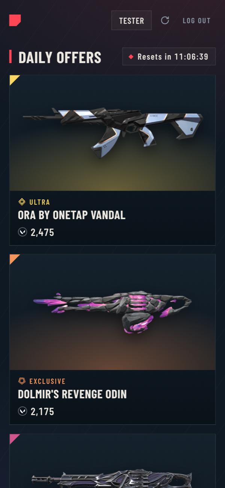

# Valoshop

**Check your Valorant store from any device → [valoshop.pages.dev](https://valoshop.pages.dev)**

Your four daily skins, the weekly accessories, the Night Market (with cards you
flip over, like in the game) and featured bundles, each with a live countdown.
No app or Discord bot needed, and it works on your phone.



<p align="center">
  
  
</p>

## Is it safe to log in?

That's a fair question for any site that asks for a Riot login, so here's how
this one works. All of it is in this repo for you to check.

- **Your password only ever goes to Riot.** "Log in with Riot" opens Riot's own
  login page at `auth.riotgames.com`. This site never sees your password.
- **What you paste is a one-hour login.** After you log in, Riot redirects to a
  `localhost` address that won't load. Its `#access_token=…` part is what you
  paste here. The token expires on Riot's side after about an hour.
- **The server keeps nothing about you.** Riot's store servers can't be called
  from a browser, so a small serverless function
  ([`src/worker.js`](src/worker.js)) makes the calls for you. It uses the token
  for a few requests to Riot, returns your store, and logs nothing. The only
  thing it stores is one global number, the "shops checked" counter on the page
  ([`migrations/`](migrations)). It has no accounts, no IPs and no history.
- **Item names and pictures** come from the community API
  [valorant-api.com](https://valorant-api.com), fetched by your browser.
- **Stay logged in is optional, and riskier.** It saves Riot's `ssid` session
  cookie in your browser so the store opens instantly. That cookie is your
  logged-in Riot session, so only use this on your own devices. Never paste it
  anywhere you don't trust.

Not affiliated with or endorsed by Riot Games. It reads the same unofficial
store endpoint the game client and Discord bots use, which Riot could change or
restrict at any time.

## How it works

```
Browser                        Cloudflare Pages Function            Riot
───────                        ─────────────────────────            ────
Log in with Riot ───────────────────────────────────────────────────▶ login page
paste redirect URL ──▶ POST /api/store
                       entitlements token, account ID, region ──────▶ auth / geo
                       storefront v3 ───────────────────────────────▶ pd.<shard>.a.pvp.net
◀── daily offers, accessories, Night Market, bundles, timers
names, images, tiers ◀── valorant-api.com
```

| Path | What it is |
| --- | --- |
| [`public/`](public) | The page: plain HTML, CSS and JavaScript, no framework or build step |
| [`src/worker.js`](src/worker.js) | The backend: token or cookie login → Riot store, normalised for the page |
| [`functions/api/[[path]].js`](functions/api/%5B%5Bpath%5D%5D.js) | Routes `/api/*` on Cloudflare Pages to the backend |
| [`test/`](test) | Tests against a fake Riot, plus a local mock server |

## Run it yourself

Requires Node 20+.

```bash
npm install
npm test        # backend tests against a fake Riot
npm run mock    # http://localhost:8787 with a fake store and no Riot account needed
npm run dev     # the real thing locally (wrangler pages dev)
```

With `npm run mock`, choose "I already have the link" and paste anything
containing `#access_token=a.b.c`.

### Deploy your own copy (free)

```bash
npx wrangler login
npx wrangler pages project create <name> --production-branch main
npx wrangler d1 create <name>          # for the shops-checked counter
npx wrangler d1 migrations apply <name> --remote
```

Set `name` in `wrangler.toml` and the `[[d1_databases]]` entry to your own
names and database id, then run `npm run deploy`. It lands at
`https://<name>.pages.dev`. The counter is optional: without the database, the
site works the same and just hides it. Cloudflare's free plan is plenty for
personal use.

## License

[MIT](LICENSE)
